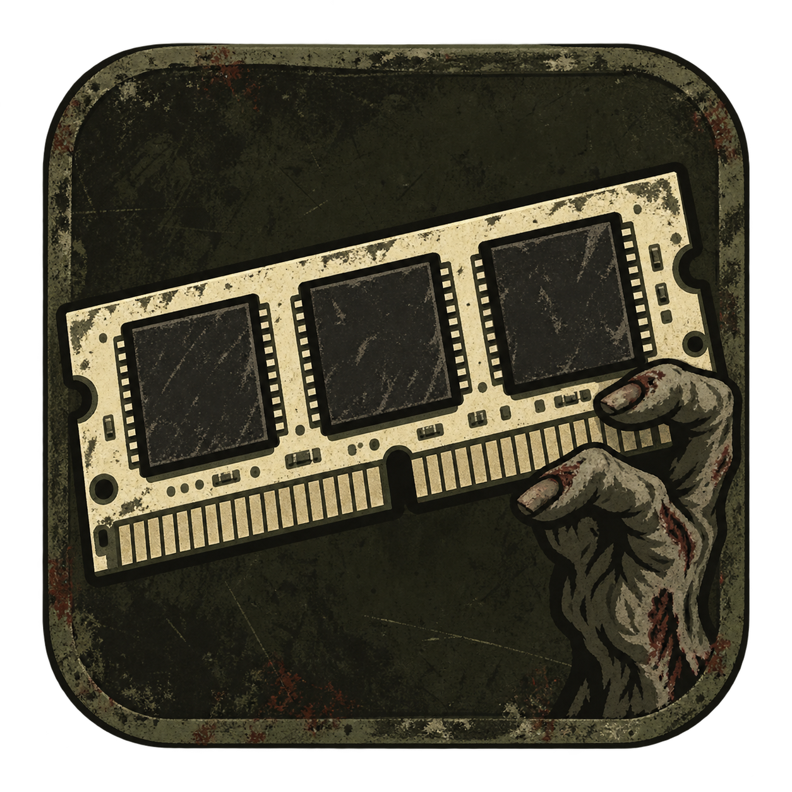
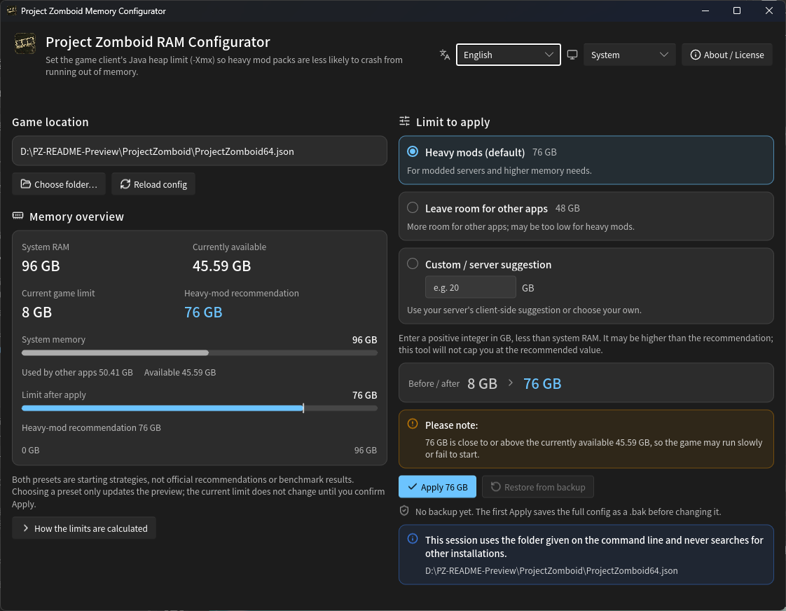

# Project Zomboid RAM Configurator

[English](README.md) · [繁體中文](README_zh-TW.md) · [简体中文](README_zh-CN.md)

A Windows tool for Project Zomboid players to adjust the **client's Java heap limit** (`-Xmx`), including memory-hungry mod lists and modded servers.



## BAT download and run

1. Download one standalone BAT: [English](https://github.com/Minidoracat/project-zomboid-ram-configurator/releases/latest/download/PZ_Memory_Configurator_EN_US.bat), [Traditional Chinese](https://github.com/Minidoracat/project-zomboid-ram-configurator/releases/latest/download/PZ_Memory_Configurator_ZH_TW.bat), or [Simplified Chinese](https://github.com/Minidoracat/project-zomboid-ram-configurator/releases/latest/download/PZ_Memory_Configurator_ZH_CN.bat). These links download the latest stable release directly; do not save a GitHub HTML page.
2. **Only one `.bat` in your preferred language is needed. No accompanying `.ps1` is required.** If using Code → Download ZIP, extract it first and take the `.bat` you want.
3. Close the game and wait for Steam updates or verification to finish.
4. Double-click the downloaded `.bat`.

No Python, Java installation or additional packages are needed. The tool uses Windows PowerShell 5.1, not WMIC. The target is 64-bit Windows 10/11; this revision was verified on Windows 11. Windows 7, Linux and macOS are not supported.

The launchers use `-NoProfile`, so your personal PowerShell startup scripts are not loaded. `-ExecutionPolicy Bypass` applies only to that PowerShell process: it does not change your permanent execution policy or override organizational policy. Only run downloads from sources you trust.

Current version: **v2.1.0**. See [Releases](https://github.com/Minidoracat/project-zomboid-ram-configurator/releases) for the Windows GUI, all three standalone BAT files, license notices and SHA256 checksums.

## Rust + Slint GUI

[Download the Windows x64 GUI](https://github.com/Minidoracat/project-zomboid-ram-configurator/releases/latest/download/pz-ram-configurator.exe). Run `pz-ram-configurator.exe` directly; no BAT or external font files are required.

The GUI and BAT work independently. The GUI provides three strategies, Traditional Chinese/English/Simplified Chinese, System/Light/Dark appearance, and a two-column layout that becomes a single column in narrow windows. Choices only update pending values until confirmed. Normal window closing is blocked while file operations are running.



Native GUI screenshot using a sample configuration. Memory figures depend on the computer and its current usage.

The interface embeds Noto Sans TC and Noto Sans SC Regular/Medium (weights 400/500) and Lucide operation icons; players do not need to install fonts or copy an assets folder. The EXE, taskbar and window header use the same original, PZ-inspired weathered RAM/zombie-hand icon, not an official Project Zomboid logo.

Developers need Rust 1.92+ and Microsoft C++ Build Tools. Players do not need Rust, .NET or WebView2 installed. The Windows x64 build uses a static CRT, but still needs Windows system DLLs and a working OpenGL driver. An unsigned EXE may show a SmartScreen warning; zero antivirus false positives are not guaranteed.

From the repository root:

```powershell
powershell.exe -NoProfile -ExecutionPolicy Bypass -File .\Build-Gui.ps1
```

The standalone output is `gui\dist\pz-ram-configurator.exe`. To select a folder and UI language (`zh-TW`, `en`, `zh-CN`) explicitly:

```powershell
.\gui\dist\pz-ram-configurator.exe --game-dir "D:\SteamLibrary\steamapps\common\ProjectZomboid" --language en
```

Heavy mods uses 80% and Leave room for other apps uses 50%, each capped at installed RAM minus 4 GB and rounded down. Neither automatic recommendation is offered below 8 GB. These are starting policies, not benchmarks; BAT behavior is unchanged. Confirmed target/backup changes are rejected, but the short compare-to-commit window is not a cross-process atomic compare-and-swap. Preserve recovery files if Windows reports a partial replacement failure.

Run native tests and static checks from `gui` so its `.cargo/config.toml` static-CRT settings apply:

```powershell
cargo test --release --locked
cargo clippy --all-targets --locked -- -D warnings
```

Translations live in `gui/locales` (`zh-TW`, `en`, `zh-CN`). Add a complete JSON catalog and register it in `BUNDLED` in `gui/src/i18n.rs`; preserve message keys/parameters and verify longer text and keyboard navigation. UI resources, translations and license text are embedded; no adjacent JSON or PowerShell files are required.

## Using the tool

The tool searches Steam and its libraries, then displays the game path, installed RAM, currently free RAM, current heap limit and recommendation.

- Select a target if multiple installations are found.
- If discovery fails, enter or drag in the game folder. It must contain `ProjectZomboid64.json` or its `.bak` backup. A backup-only folder can still enter the restore workflow.
- Spaces, Chinese characters, apostrophes, brackets and exclamation marks in paths are supported.

BAT menu:

| Option | Action |
| --- | --- |
| 1 | Apply the heavy-mod recommendation |
| 2 | Enter a whole-number GB limit, including a server's **client-side** recommendation; enter 0 to go back |
| 3 | Restore the complete configuration from `ProjectZomboid64.json.bak` |
| 0 | Quit |

Applying or restoring requires confirmation. Only `y` proceeds; Enter or another response cancels. Changes take effect on the next game launch. The tool never lowers your current setting automatically.

The GUI uses on-window strategies, confirm buttons and restore — not this numbered menu. Three strategies, appearance and language switching belong to the GUI; BAT still has only the options above, with unchanged strategies.

## Heavy-mod recommendation

The recommendation uses the **sum of installed memory-module capacities**, not the amount left free by background applications:

`floor(min(physical RAM × 80%, physical RAM − 4 GB))`

| Installed RAM | Recommended limit |
| --- | --- |
| 8 GB | 4 GB |
| 12 GB | 8 GB |
| 16 GB | 12 GB |
| 24 GB | 19 GB |
| 32 GB | 25 GB |
| 64 GB | 51 GB |

Here, GB means 1024³ bytes, matching the JVM's `g` unit.

- This is a **starting policy for heavy mods**, not an official PZ optimum or a benchmark result.
- `-Xmx` caps the Java heap. It does not allocate the entire amount immediately and is not a cap on total process memory. Increasing it does not guarantee more FPS.
- Below 8 GB, automatic recommendations are disabled but custom input remains available. If installed RAM cannot be detected, only restore/quit are available.
- Custom values must be positive whole numbers **below installed RAM**. They may exceed the recommendation.
- Values above the recommendation, below the current limit, or close to/above the free RAM measured during startup trigger warnings before confirmation. Leaving 4 GB is not a guarantee that every background workload will fit.
- This changes the player's client configuration, not dedicated-server startup parameters. Do not copy a server host's RAM allocation without checking that it is intended for clients.

## Backups and safe writes

- Only the unique `-Xmx` value is replaced. Other content, formatting, Unicode and UTF-8 BOM presence are preserved. `-Xms` is never changed.
- Existing sizes may use `k`, `m`, `g` (either case), or bytes without a suffix. Missing/duplicate/invalid arguments, non-UTF-8 files and ambiguous edits are rejected rather than guessed.
- A new limit below an existing `-Xms` is rejected; resolve that conflict yourself first.
- A temporary file in the same directory is validated before atomic replacement. The complete pre-change file becomes `.bak`. Each actual change replaces that backup with the previous version; setting the same limit writes neither file.
- Read-only files, insufficient permissions or filesystems without atomic replacement cause failure. The tool does not fall back to unsafe direct overwrites. Follow the error details to resolve the cause.
- Some Windows replacement errors can occur after files have already been moved; not every operating-system failure leaves every file unchanged. On replacement failure, the tool retains the candidate and previous-backup copy and reports recovery paths. **Preserve and inspect these files before retrying; do not delete them blindly.**
- If another program changes the configuration while you are confirming, the write is rejected. Read the new state and confirm again.
- The file is read back and checked before success is reported.
- Restore keeps `.bak` intact and can recover a damaged or missing JSON file from a valid backup. **It restores the whole configuration and can undo game updates or manual edits. Do not blindly restore a backup from another game version.**

Steam updates or game verification may reset the limit; open the tool again to check. If the configuration is damaged and no valid backup is available, use Steam's **Verify integrity of game files**, then configure it again.

## Development and verification

Maintain the shared logic only in `PZ_Memory_Configurator.ps1`. `Build-Standalone.ps1` embeds that same core into the three root-level `.bat` files (`PZ_Memory_Configurator_ZH_TW.bat`, `PZ_Memory_Configurator_EN_US.bat`, `PZ_Memory_Configurator_ZH_CN.bat`). Do not edit the generated `.bat` files directly. They contain readable source and execute the core in memory, without downloading code or creating a temporary `.ps1`.

After editing the core, regenerate the standalone files locally (this does not upload anything or create a Release):

```powershell
powershell.exe -NoProfile -ExecutionPolicy Bypass -File .\Build-Standalone.ps1
```

Use `-OutputDirectory "D:\PZ-release"` for another output folder. The build produces three standalone `.bat` files; players only need the one in their preferred language.

Run the isolated regression checks; they do not modify real game settings:

```powershell
powershell.exe -NoProfile -ExecutionPolicy Bypass -File .\tests\MemoryConfigurator.Tests.ps1
powershell.exe -NoProfile -ExecutionPolicy Bypass -File .\tests\Standalone.Tests.ps1
```

The standalone checks verify that root-level `.bat` files match the current core, packaging is reproducible, and the generated launchers start and immediately quit from an isolated folder with no `.ps1`. They also check nonzero exit codes for truncated downloads. These checks may read local Steam/game information but never modify game settings.

To open the interactive tool for a specific directory, BAT language codes are `en-US`, `zh-TW`, and `zh-CN`:

```powershell
powershell.exe -NoProfile -ExecutionPolicy Bypass -File .\PZ_Memory_Configurator.ps1 -Language en-US -GameDirectory "D:\SteamLibrary\steamapps\common\ProjectZomboid"
```

This is the real configuration workflow and still asks for confirmation before writing. Passing regression checks does not establish compatibility with every PZ version, launcher or mod list, or demonstrate a performance improvement.

A real file-lock failure was also exercised to check recovery-file retention. Windows partial-replacement errors `1176`/`1177` and power-loss scenarios were not reproduced.

## License

This project is licensed under **GNU GPL version 3 only** (`GPL-3.0-only`); see [LICENSE](LICENSE). Use, study, modification and commercial use are allowed. Redistribution must comply with the GPL, preserve notices, and provide corresponding source/build information: the PowerShell core and packager for BAT, and the `gui` source, resources, `Cargo.lock`, build configuration and required dependency license/source information for the GUI. Embedding the license text in an EXE does not by itself fulfill every redistribution obligation.

Bundled Noto Sans TC/SC fonts retain the **SIL Open Font License 1.1**; Lucide icons retain their **ISC / Feather MIT** notices. Full notices are available in **About / License** inside the EXE. `Build-Gui.ps1` also copies `LICENSE.txt`, `NotoSansCJK-LICENSE.txt` and `Lucide-LICENSE.txt` into `gui/dist`; these are distribution notices, not runtime dependencies. Asset origins are recorded under `gui/assets`.

This license statement applies to the current source code. It does not retroactively revoke permissions already granted for previously published releases.

## Support

Report problems in a GitHub issue or on [Discord](https://discord.gg/Gur2V67). Include the error, Windows version, game version and launch method. Redact personal information from paths before sharing them.
