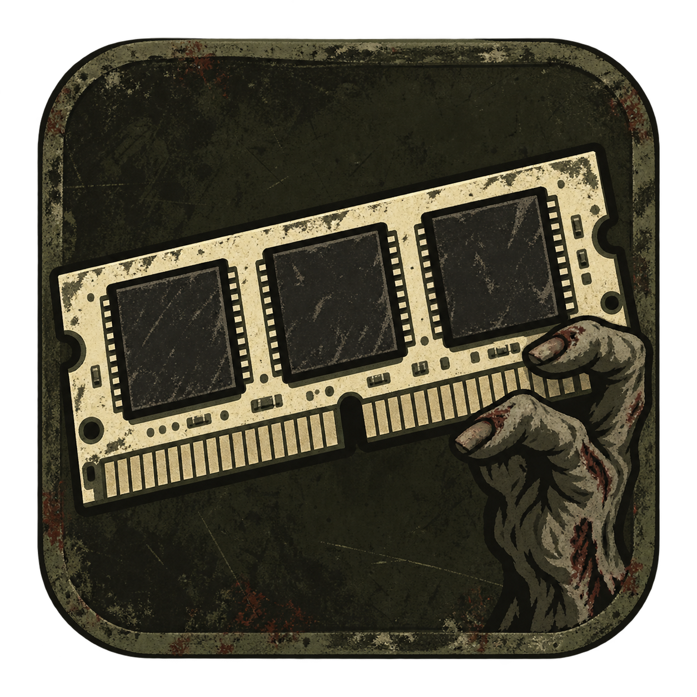
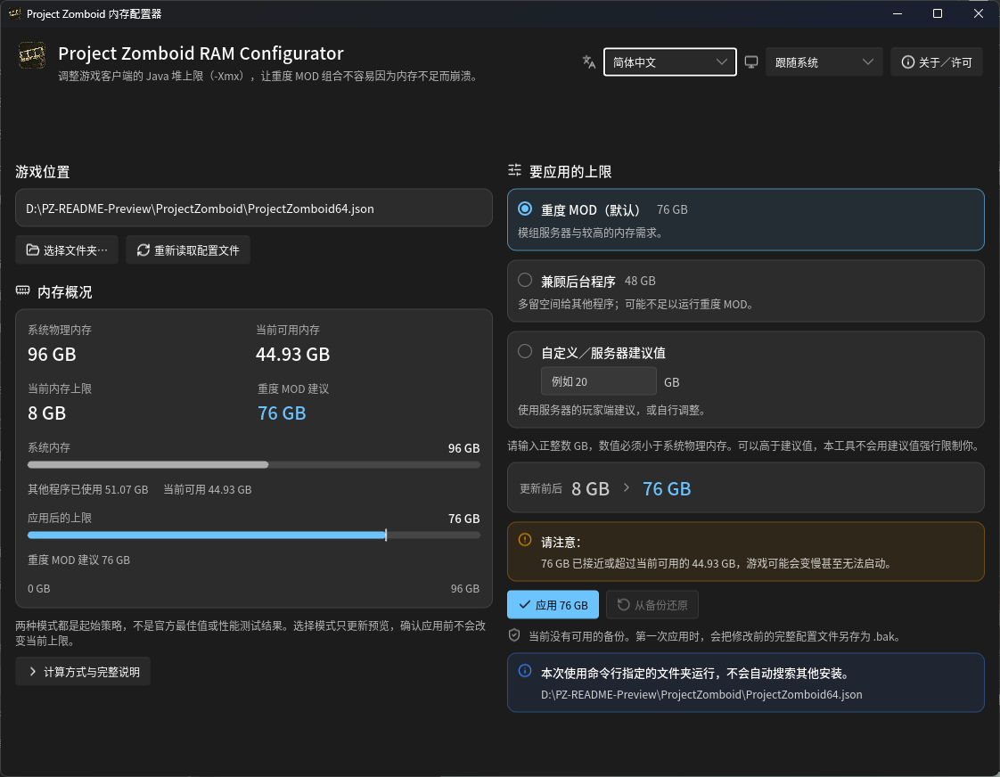

# Project Zomboid RAM Configurator

[English](README.md) · [繁體中文](README_zh-TW.md) · [简体中文](README_zh-CN.md)

供 Project Zomboid 玩家使用的 Windows 小工具，用于调整游戏客户端的 Java 堆内存上限（`-Xmx`），适合需要较多内存的 MOD 组合与模组服务器。



## BAT 下载与运行

1. 从 GitHub Releases 下载已发布的 [繁体中文版 PZ_Memory_Configurator_ZH_TW.bat](https://github.com/Minidoracat/project-zomboid-ram-configurator/releases/latest/download/PZ_Memory_Configurator_ZH_TW.bat)，或 [英文版 PZ_Memory_Configurator_EN_US.bat](https://github.com/Minidoracat/project-zomboid-ram-configurator/releases/latest/download/PZ_Memory_Configurator_EN_US.bat)。以上链接直接下载当前最新正式版，不要另存 GitHub 网页。
2. **简体中文启动器 `PZ_Memory_Configurator_ZH_CN.bat` 目前只存在于仓库源代码／本地构建产物，尚未随 v2.0.0 正式发布，因此没有 GitHub `latest/download` 链接。** 需要简体中文 BAT 时，请从本仓库取得该文件，或在本地运行 `Build-Standalone.ps1` 生成。不要把尚未发布的文件名拼进 Releases 下载地址。
3. **只需选用语言的一支 `.bat`，不需要旁边的 `.ps1`。** 若使用 Code → Download ZIP，先解压，再取出要用的 `.bat` 即可。ZIP 里的 `PZ_Memory_Configurator_ZH_CN.bat` 同样是源代码版本，不是 GitHub Release 资源。
4. 关闭游戏，并等待 Steam 的更新或验证作业完成。
5. 已发布版本请双击 `PZ_Memory_Configurator_ZH_TW.bat` 或 `PZ_Memory_Configurator_EN_US.bat`。若使用本地／源代码中的简体中文入口，请双击 `PZ_Memory_Configurator_ZH_CN.bat`。

无需安装 Python、Java 或其他软件包；使用 Windows PowerShell 5.1，不再依赖 WMIC。目标环境为 Windows 10／11 64 位；本次验证环境为 Windows 11。Windows 7、Linux、macOS 不在支持范围。

`.bat` 使用 `-NoProfile`，不加载个人的 PowerShell 启动脚本。`-ExecutionPolicy Bypass` 只应用到这次 PowerShell 进程，不修改永久执行策略，也不能取代公司／学校的管理策略。只运行你信任来源的下载内容。

当前版本为 **v2.0.0**。完整版本记录与已发布单文件下载请见 [Releases](https://github.com/Minidoracat/project-zomboid-ram-configurator/releases)；该版本目前只有繁体中文与英文两支 BAT。仓库已更名，旧版 `.bat` 文件名保持不变。

本工具的 **BAT** 与 **GUI** 彼此独立：BAT 是命令行启动器；GUI 是 `gui\dist\pz-ram-configurator.exe`。不要把 GUI 的语言参数套到 `.bat`，也不要把 BAT 菜单选项当成 GUI 按钮。

## Rust＋Slint 图形界面（本地版本，尚未发布）

GUI 与 BAT 可以独立使用，互不调用。GUI 提供三种策略、繁体中文／English／简体中文、跟随系统／浅色／深色、宽屏双栏与窄屏单栏；切换选项只更新待应用值，确认后才写入。保存期间不允许直接关闭窗口。



正式 GUI 截图，使用示例配置；内存数值因电脑与当前使用情况而异。

界面内嵌 Noto Sans TC 与 Noto Sans SC Regular／Medium（字重 400／500）以及 Lucide 操作图标，玩家不必另装字体或携带资源文件夹。EXE、任务栏与窗口标题栏使用同一枚 PZ 末日风格的磨损 RAM／僵尸手原创图标，不是 Project Zomboid 官方 logo。

开发机需要 Rust 1.92 以上与 Microsoft C++ Build Tools；玩家不需要安装 Rust、.NET 或 WebView2。使用 Windows x64 静态 CRT 构建，仍需 Windows 系统 DLL 与正常的 OpenGL 显示驱动。未签名的 EXE 仍可能显示 SmartScreen 警告；本项目不保证杀毒软件零误报。

在仓库根目录执行：

```powershell
powershell.exe -NoProfile -ExecutionPolicy Bypass -File .\Build-Gui.ps1
```

产物为 `gui\dist\pz-ram-configurator.exe`，可单独复制运行。也可明确指定游戏文件夹与界面语言（`zh-TW`、`en`、`zh-CN`）：

```powershell
.\gui\dist\pz-ram-configurator.exe --game-dir "D:\SteamLibrary\steamapps\common\ProjectZomboid" --language zh-CN
```

GUI 的「重度 MOD」使用 80%、「兼顾后台程序」使用 50%，皆取与「物理 RAM − 4 GB」较小值后向下取整；低于 8 GB 不提供自动建议。这些是起始策略，不是性能实测结果；BAT 的策略保持不变。配置与备份若在确认期间被修改，会拒绝操作；极短提交窗口不保证具备跨进程原子比较交换，操作系统部分替换失败时仍需保全恢复文件。

原生核心测试与静态检查请在 `gui` 目录执行（该目录的 `.cargo/config.toml` 会启用静态 CRT）：

```powershell
cargo test --release --locked
cargo clippy --all-targets --locked -- -D warnings
```

语言资源位于 `gui/locales`（已有 `zh-TW`、`en`、`zh-CN`）。新增语言时加入完整 JSON 并在 `gui/src/i18n.rs` 的 `BUNDLED` 注册。必须保持消息 key 与参数一致，并验证较长文本与键盘操作。GUI 的源代码、资源与许可均编译进 EXE，不依赖旁边的 JSON 或 `.ps1`。

## 操作流程

工具会查找 Steam 及其各个库，显示游戏位置、系统物理内存、当前可用内存、当前游戏上限与建议值。

- 找到多份安装时，可选择目标。
- 自动检测失败时，可输入游戏文件夹或将文件夹拖入窗口；该目录需有 `ProjectZomboid64.json` 或其 `.bak` 备份。仅剩备份时仍可进入还原流程。
- 支持路径中的中文、空格、单引号、方括号与感叹号。

BAT 菜单：

| 选项 | 功能 |
| --- | --- |
| 1 | 应用重度 MOD 建议值 |
| 2 | 自定义整数 GB 上限，也可使用服务器提供的**客户端**建议值；输入 0 返回 |
| 3 | 从 `ProjectZomboid64.json.bak` 还原完整配置文件 |
| 0 | 退出 |

应用与还原都会再次确认；只有输入 `y` 才执行，直接按 Enter 或输入其他内容会取消。修改在下次启动游戏时生效。工具不会自动降低当前设置。

GUI 使用窗口中的策略、确认按钮与还原流程，没有上述数字菜单。三种策略、外观与语言切换属于 GUI；BAT 仍只有上表选项，策略不变。

## 重度 MOD 建议值

以**实际安装的内存模块容量总和**计算，不因当下后台程序占用而改变永久推荐值：

`向下取整 min(物理 RAM × 80%, 物理 RAM − 4 GB)`

| 系统物理 RAM | 建议上限 |
| --- | --- |
| 8 GB | 4 GB |
| 12 GB | 8 GB |
| 16 GB | 12 GB |
| 24 GB | 19 GB |
| 32 GB | 25 GB |
| 64 GB | 51 GB |

本工具的 GB 以 1024³ bytes 计算，与 JVM 的 `g` 单位一致。

- 这是重度 MOD 的**起始策略**，不是 PZ 官方最佳值，也不是性能测量结果。
- `-Xmx` 是 Java 堆内存上限，不是启动后立即占用的容量，也不是游戏进程的总内存上限。调高不保证提升 FPS。
- 少于 8 GB 不提供自动推荐，但仍可自行输入；无法检测物理容量时，停用修改，只保留还原／退出。
- 自定义值必须是正整数且**小于物理 RAM**；可以高于推荐值，不会被推荐值硬性限制。
- 高于推荐值、低于当前设置、或接近／超过当次检测的可用内存时，确认前会显示警告。至少保留 4 GB 不代表所有后台程序都一定足够。
- 本工具修改玩家端配置，不修改独立服务器的启动参数，不能直接照抄服务器主机的 RAM 配置。

## 备份、写入与失败处理

- 只替换配置文件中的唯一 `-Xmx` 值，其余内容、格式、Unicode 与 UTF-8 BOM 状态保持不变；不更改 `-Xms`。
- 支持 `k`／`m`／`g`（大小写皆可）与无单位 bytes。缺少／重复／无效参数、非 UTF-8 或无法安全判断的文件会拒绝修改，不猜测修复。
- 新上限低于既有 `-Xms` 时拒绝写入，需先自行处理冲突。
- 同目录临时文件通过验证后才原子替换，并将操作前的完整文件保存为 `.bak`。再次修改会更新为上一版备份；设置值没变时不写文件、不更新备份。
- 若文件只读、权限不足或文件系统不支持原子替换，操作会失败；不退回有中断风险的直接覆盖方式。请依画面错误排除原因。
- Windows 的替换 API 在少数失败情境可能已搬移部分文件，不能保证每种操作系统错误都完全不动文件。若替换失败，工具保留候选配置与先前备份副本，并列出恢复位置；**先保全这些文件并检查状态，不要直接重试或删除它们。**
- 若配置在显示后、确认期间被其他程序修改，会拒绝覆盖；请重新读取并确认新状态。
- 操作完成后会回读验证，成功才显示完成。
- 还原会保留 `.bak`，当前 JSON 已损坏或丢失时也可使用有效备份还原。**还原的是整份配置文件，可能撤销 Steam 更新或其他手动修改；不要盲目还原不同游戏版本的旧备份。**

Steam 更新或验证游戏后可能重置上限，请重新打开工具检查。若没有可用备份且配置文件已损坏，可使用 Steam 的「验证游戏文件完整性」修复，再重新配置。

## 开发与验证

共用逻辑只维护 `PZ_Memory_Configurator.ps1`；`Build-Standalone.ps1` 会把同一份核心内嵌成根目录的三支 `.bat`（`PZ_Memory_Configurator_ZH_TW.bat`、`PZ_Memory_Configurator_EN_US.bat`、`PZ_Memory_Configurator_ZH_CN.bat`）。不要直接修改生成的 `.bat`。它们使用可读源代码，在内存内执行核心，不下载其他程序，也不创建临时 `.ps1`。

修改核心后，重新生成本地单文件（只生成本地文件，不上传、不创建 Release）：

```powershell
powershell.exe -NoProfile -ExecutionPolicy Bypass -File .\Build-Standalone.ps1
```

可使用 `-OutputDirectory "D:\PZ-release"` 指定输出文件夹。本地会得到三支 `.bat`；**v2.0.0 正式发布目前只提供繁体中文与英文两支**，玩家从 Releases 只需下载其中一支。`PZ_Memory_Configurator_ZH_CN.bat` 仍是本地／源代码版本，尚未发布。

执行不接触真实游戏设置的隔离回归检查：

```powershell
powershell.exe -NoProfile -ExecutionPolicy Bypass -File .\tests\MemoryConfigurator.Tests.ps1
powershell.exe -NoProfile -ExecutionPolicy Bypass -File .\tests\Standalone.Tests.ps1
```

单文件检查会确认根目录 `.bat` 与当前核心同步、打包可复现，并在不含 `.ps1` 的独立文件夹启动后立即退出；也会检查截断下载的非零退出码。这项检查可能读取本地 Steam／游戏信息，但不修改游戏设置。

指定语言直接操作核心脚本时，BAT 语言代码为 `zh-TW`、`en-US`、`zh-CN`：

```powershell
powershell.exe -NoProfile -ExecutionPolicy Bypass -File .\PZ_Memory_Configurator.ps1 -Language zh-CN -GameDirectory "D:\SteamLibrary\steamapps\common\ProjectZomboid"
```

此命令会打开真正的修改流程；仍需用户确认才写入。回归检查不代表所有 PZ 版本、启动器与 MOD 组合均已验证，也不代表已测得性能提升。

本次另以真实文件锁验证替换失败时的恢复文件保留；未实际触发 Windows `1176`／`1177` 部分替换错误或断电情境。

## 许可

本项目采用 **GNU 通用公共许可协议第 3 版（仅第 3 版，`GPL-3.0-only`）**，完整条款见 [LICENSE](LICENSE)。你可以自由使用、研究、修改与运行，包含商业用途。若分发程序或修改版，须遵守 GPL、保留版权与许可声明，并提供相应源代码及构建信息：BAT 包含 PowerShell 核心与打包器；GUI 包含 `gui` 源代码、资源、`Cargo.lock`、构建设置与依赖组件所需许可／来源信息。只提供 EXE 内的许可文本，不等于已履行全部分发义务。

内嵌 Noto Sans TC／Noto Sans SC 字体保留 **SIL Open Font License 1.1**；Lucide 图标保留 **ISC／Feather MIT** 声明。EXE 的「关于／许可」可查看完整条款。`Build-Gui.ps1` 也会将 `LICENSE.txt`、`NotoSansCJK-LICENSE.txt` 与 `Lucide-LICENSE.txt` 复制到 `gui/dist`；这些是分发声明，不是运行依赖。素材来源记录于 `gui/assets`。

本许可声明适用于当前的源代码，不追溯撤销先前已发布版本既已授予的许可。

## 反馈

问题请在 GitHub 开启 issue，或加入 [Discord](https://discord.gg/Gur2V67)。反馈时请附上错误消息、Windows 版本、游戏版本与启动方式；分享路径前可先遮蔽个人信息。
