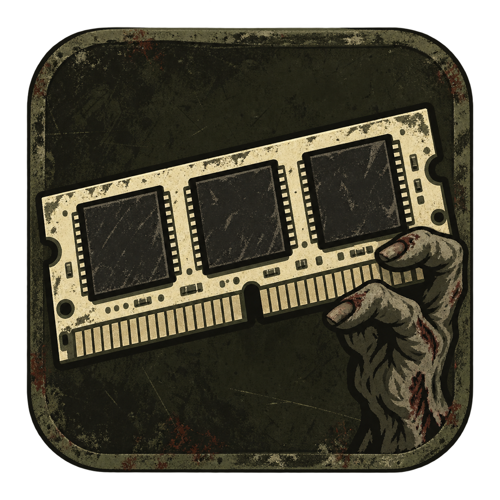
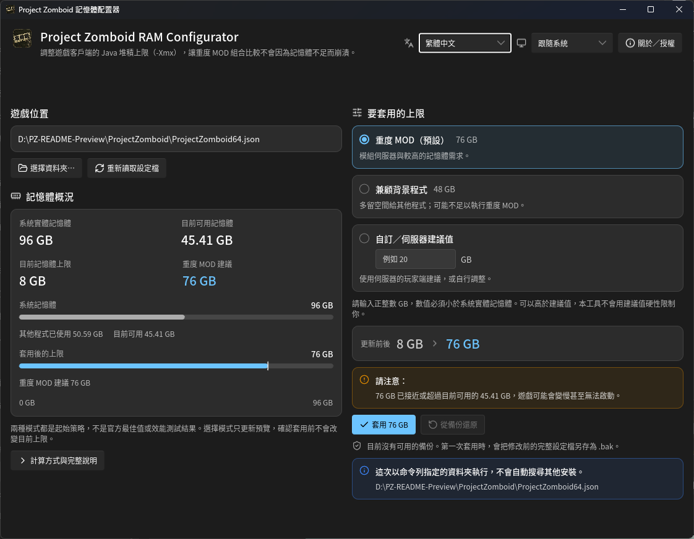

# Project Zomboid RAM Configurator

[English](README.md) · [繁體中文](README_zh-TW.md) · [简体中文](README_zh-CN.md)

給 Project Zomboid 玩家使用的 Windows 小工具，協助調整遊戲客戶端的 Java 堆積記憶體上限（`-Xmx`），適合需要較多記憶體的 MOD 組合與模組伺服器。



## BAT 下載與執行

1. 下載 [繁體中文版 PZ_Memory_Configurator_ZH_TW.bat](https://github.com/Minidoracat/project-zomboid-ram-configurator/releases/latest/download/PZ_Memory_Configurator_ZH_TW.bat)，或 [英文版 PZ_Memory_Configurator_EN_US.bat](https://github.com/Minidoracat/project-zomboid-ram-configurator/releases/latest/download/PZ_Memory_Configurator_EN_US.bat)。以上連結直接下載最新正式版，不需要另存 GitHub 網頁。
2. **簡體中文啟動器 `PZ_Memory_Configurator_ZH_CN.bat` 目前只存在於倉庫原始碼／本機建置產物，尚未隨 v2.0.0 正式發布，因此沒有 GitHub `latest/download` 連結。** 需要簡體中文 BAT 時，請從本倉庫取得該檔，或在本機執行 `Build-Standalone.ps1` 產生。不要把尚未發布的檔名拼進 Releases 下載網址。
3. **只需選用語言的一支 `.bat`，不需要旁邊的 `.ps1`。** 若使用 Code → Download ZIP，先解壓縮，再取出要用的 `.bat` 即可。ZIP 裡的 `PZ_Memory_Configurator_ZH_CN.bat` 同樣是原始碼版本，不是 GitHub Release 資源。
4. 關閉遊戲，並等待 Steam 的更新或驗證作業完成。
5. 雙擊 `PZ_Memory_Configurator_ZH_TW.bat`。英文入口是 `PZ_Memory_Configurator_EN_US.bat`。若使用尚未發布的簡體中文入口，請雙擊本機的 `PZ_Memory_Configurator_ZH_CN.bat`。

不需安裝 Python、Java 或其他套件；使用 Windows PowerShell 5.1，不再依賴 WMIC。目標環境為 Windows 10／11 64 位元；本次驗證環境為 Windows 11。Windows 7、Linux、macOS 不在支援範圍。

`.bat` 使用 `-NoProfile`，不載入個人的 PowerShell 啟動腳本。`-ExecutionPolicy Bypass` 只套用到這次 PowerShell 程序，不修改永久執行原則，也不能取代公司／學校的管理政策。只執行你信任來源的下載內容。

目前版本為 **v2.0.0**。完整版本紀錄與已發布單檔下載請見 [Releases](https://github.com/Minidoracat/project-zomboid-ram-configurator/releases)；該版本目前只有繁體中文與英文兩支 BAT。儲存庫已更名，舊版 `.bat` 檔名保持不變。

## Rust＋Slint 圖形介面（本機版本，尚未發布）

GUI 與 BAT 可以獨立使用，彼此不互相呼叫。GUI 提供三種策略、繁體中文／English／簡體中文、跟隨系統／淺色／深色選擇、寬版雙欄與窄版單欄；切換選項只更新待套用值，確認後才寫入。保存期間不允許直接關閉視窗。



正式 GUI 截圖，使用範例設定；記憶體數值依電腦與當下使用狀態而異。

介面內嵌 Noto Sans TC 與 Noto Sans SC Regular／Medium（字重 400／500）與 Lucide 操作圖示，玩家不必另裝字型或攜帶資源資料夾。EXE、工作列與視窗標頭使用同一枚 PZ 末日風格的磨損 RAM／殭屍手原創圖示，不是 Project Zomboid 官方 logo。

開發機需要 Rust 1.92 以上與 Microsoft C++ Build Tools；玩家不需要安裝 Rust、.NET 或 WebView2。使用 Windows x64 靜態 CRT 建置，仍需 Windows 系統 DLL 與正常的 OpenGL 顯示驅動。未簽章的 EXE 仍可能顯示 SmartScreen 警告；本專案不保證防毒零誤報。

在 repo 根目錄執行：

```powershell
powershell.exe -NoProfile -ExecutionPolicy Bypass -File .\Build-Gui.ps1
```

產物為 `gui\dist\pz-ram-configurator.exe`，可單獨複製執行。也可明確指定遊戲資料夾與介面語言（`zh-TW`、`en`、`zh-CN`）：

```powershell
.\gui\dist\pz-ram-configurator.exe --game-dir "D:\SteamLibrary\steamapps\common\ProjectZomboid" --language zh-TW
```

GUI 的「重度 MOD」使用 80%、「兼顧背景程式」使用 50%，皆取與「實體 RAM − 4 GB」較小值後向下取整；低於 8 GB 不提供自動建議。這些是起始策略，不是效能實測結果；BAT 的策略維持原樣。設定與備份若在確認期間被修改，會拒絕操作；極短提交窗口不保證具備跨程序原子比較交換，作業系統部分替換失敗時仍需保全回復檔。

原生核心測試與靜態檢查請在 `gui` 目錄執行（該目錄的 `.cargo/config.toml` 會啟用靜態 CRT）：

```powershell
cargo test --release --locked
cargo clippy --all-targets --locked -- -D warnings
```

語系資源位於 `gui/locales`（已有 `zh-TW`、`en`、`zh-CN`），新增語言時加入完整 JSON 並在 `gui/src/i18n.rs` 的 `BUNDLED` 註冊。必須維持訊息 key 與參數一致，並驗證較長文字與鍵盤操作。GUI 的原始碼、資源與授權均編譯進 EXE，不依賴旁邊的 JSON 或 `.ps1`。

## 操作流程

工具會尋找 Steam 與各個收藏庫，顯示遊戲位置、系統實體記憶體、目前可用記憶體、目前遊戲上限與建議值。

- 找到多份安裝時，可選擇目標。
- 自動偵測失敗時，可輸入遊戲資料夾或將資料夾拖入視窗；該目錄需有 `ProjectZomboid64.json` 或其 `.bak` 備份。僅剩備份時仍可進入還原流程。
- 支援路徑中的中文、空白、單引號、方括號與驚嘆號。

BAT 選單：

| 選項 | 功能 |
| --- | --- |
| 1 | 套用重度 MOD 建議值 |
| 2 | 自訂整數 GB 上限，也可使用伺服器提供的**客戶端**建議值；輸入 0 返回 |
| 3 | 從 `ProjectZomboid64.json.bak` 還原完整設定檔 |
| 0 | 離開 |

套用與還原都會再次確認；只有輸入 `y` 才執行，直接按 Enter 或輸入其他內容會取消。修改在下次啟動遊戲時生效。工具不會自動降低目前設定。

GUI 使用視窗中的策略、確認按鈕與還原流程，沒有上述數字選單。三種策略、外觀與語言切換屬於 GUI；BAT 仍只有上表選項，策略不變。

## 重度 MOD 建議值

以**實際安裝的記憶體模組容量總和**計算，不因當下背景程式占用而改變永久推薦值：

`向下取整 min(實體 RAM × 80%, 實體 RAM − 4 GB)`

| 系統實體 RAM | 建議上限 |
| --- | --- |
| 8 GB | 4 GB |
| 12 GB | 8 GB |
| 16 GB | 12 GB |
| 24 GB | 19 GB |
| 32 GB | 25 GB |
| 64 GB | 51 GB |

本工具的 GB 以 1024³ bytes 計算，與 JVM 的 `g` 單位一致。

- 這是重度 MOD 的**起始策略**，不是 PZ 官方最佳值，也不是效能量測結果。
- `-Xmx` 是 Java 堆積記憶體上限，不是啟動後立即占用的容量，也不是遊戲程序的總記憶體上限。調高不保證提升 FPS。
- 少於 8 GB 不提供自動推薦，但仍可自行輸入；無法偵測實體容量時，停用修改，只保留還原／離開。
- 自訂值必須是正整數且**小於實體 RAM**；可以高於推薦值，不會被推薦值硬性限制。
- 高於推薦值、低於目前設定、或接近／超過當次偵測的可用記憶體時，確認前會顯示警告。至少保留 4 GB 不代表所有背景程式都一定足夠。
- 本工具修改玩家端設定，不修改獨立伺服器的啟動參數，不能直接照抄伺服器主機的 RAM 配置。

## 備份、寫入與失敗處理

- 只替換設定檔中的唯一 `-Xmx` 值，其餘內容、格式、Unicode 與 UTF-8 BOM 狀態保持不變；不更改 `-Xms`。
- 支援 `k`／`m`／`g`（大小寫皆可）與無單位 bytes。缺少／重複／無效參數、非 UTF-8 或無法安全判斷的檔案會拒絕修改，不猜測修復。
- 新上限低於既有 `-Xms` 時拒絕寫入，需先自行處理衝突。
- 同目錄暫存檔通過驗證後才原子替換，並將操作前的完整檔案保存為 `.bak`。再次修改會更新為上一版備份；設定值沒變時不寫檔、不更新備份。
- 若檔案唯讀、權限不足或檔案系統不支援原子替換，操作會失敗；不退回有中斷風險的直接覆寫方式。請依畫面錯誤排除原因。
- Windows 的替換 API 在少數失敗情境可能已搬移部分檔案，不能保證每種作業系統錯誤都完全不動檔。若替換失敗，工具保留候選設定與先前備份副本，並列出回復位置；**先保全這些檔案並檢查狀態，不要直接重試或刪除它們。**
- 若設定在顯示後、確認期間被其他程式修改，會拒絕覆寫；請重新讀取並確認新狀態。
- 操作完成後會回讀驗證，成功才顯示完成。
- 還原會保留 `.bak`，目前 JSON 已損壞或遺失時也可使用有效備份還原。**還原的是整份設定檔，可能撤銷 Steam 更新或其他手動修改；不要盲目還原不同遊戲版本的舊備份。**

Steam 更新或驗證遊戲後可能重設上限，請重新開啟工具檢查。若沒有可用備份且設定檔已損壞，可使用 Steam 的「驗證遊戲檔案完整性」修復，再重新設定。

## 開發與驗證

共用邏輯只維護 `PZ_Memory_Configurator.ps1`；`Build-Standalone.ps1` 會把同一份核心內嵌成根目錄的三支 `.bat`（`PZ_Memory_Configurator_ZH_TW.bat`、`PZ_Memory_Configurator_EN_US.bat`、`PZ_Memory_Configurator_ZH_CN.bat`）。不要直接修改產生的 `.bat`。它們使用可讀原始碼，在記憶體內執行核心，不下載其他程式，也不建立暫存 `.ps1`。

修改核心後，重新產生單檔發布檔（只產生本機檔案，不上傳、不建立 Release）：

```powershell
powershell.exe -NoProfile -ExecutionPolicy Bypass -File .\Build-Standalone.ps1
```

可使用 `-OutputDirectory "D:\PZ-release"` 指定輸出資料夾。本機會得到三支 `.bat`；**v2.0.0 正式發布目前只提供繁體中文與英文兩支**，玩家從 Releases 只需下載其中一支。`PZ_Memory_Configurator_ZH_CN.bat` 仍是本機／原始碼版本，尚未發布。

執行不接觸真實遊戲設定的隔離回歸檢查：

```powershell
powershell.exe -NoProfile -ExecutionPolicy Bypass -File .\tests\MemoryConfigurator.Tests.ps1
powershell.exe -NoProfile -ExecutionPolicy Bypass -File .\tests\Standalone.Tests.ps1
```

單檔檢查會確認根目錄 `.bat` 與目前核心同步、打包可重現，並在不含 `.ps1` 的獨立資料夾啟動後立即退出；也會檢查截斷下載的非零結束碼。這項檢查可能讀取本機 Steam／遊戲資訊，但不修改遊戲設定。

指定遊戲目錄直接操作時，BAT 語言代碼為 `zh-TW`、`en-US`、`zh-CN`：

```powershell
powershell.exe -NoProfile -ExecutionPolicy Bypass -File .\PZ_Memory_Configurator.ps1 -Language zh-TW -GameDirectory "D:\SteamLibrary\steamapps\common\ProjectZomboid"
```

此指令會開啟真正的修改流程；仍需使用者確認才寫入。回歸檢查不代表所有 PZ 版本、啟動器與 MOD 組合均已驗證，也不代表已測得效能提升。

本次另以真實檔案鎖驗證替換失敗時的回復檔保留；未實際觸發 Windows `1176`／`1177` 部分替換錯誤或斷電情境。

## 授權

本專案採用 **GNU 通用公共授權條款第 3 版（僅第 3 版，`GPL-3.0-only`）**，完整條文見 [LICENSE](LICENSE)。你可以自由使用、研究、修改與執行，包含商業用途。若散布程式或修改版，須遵守 GPL、保留著作權與授權聲明，並提供相應原始碼及建置資訊：BAT 包含 PowerShell 核心與打包器；GUI 包含 `gui` 原始碼、資源、`Cargo.lock`、建置設定與相依元件所需授權／來源資訊。只提供 EXE 內的授權文字，不等於已履行全部散布義務。

內嵌 Noto Sans TC／Noto Sans SC 字型保留 **SIL Open Font License 1.1**；Lucide 圖示保留 **ISC／Feather MIT** 聲明。EXE 的「關於／授權」可檢視完整條文。`Build-Gui.ps1` 也會將 `LICENSE.txt`、`NotoSansCJK-LICENSE.txt` 與 `Lucide-LICENSE.txt` 複製至 `gui/dist`；這些是散布聲明，不是執行依賴。素材來源記錄於 `gui/assets`。

本授權聲明適用於目前的原始碼，不追溯撤銷先前已發布版本既已授予的許可。

## 回報

問題請在 GitHub 開啟 issue，或加入 [Discord](https://discord.gg/Gur2V67)。回報時請附上錯誤訊息、Windows 版本、遊戲版本與啟動方式；分享路徑前可先遮蔽個人資訊。
